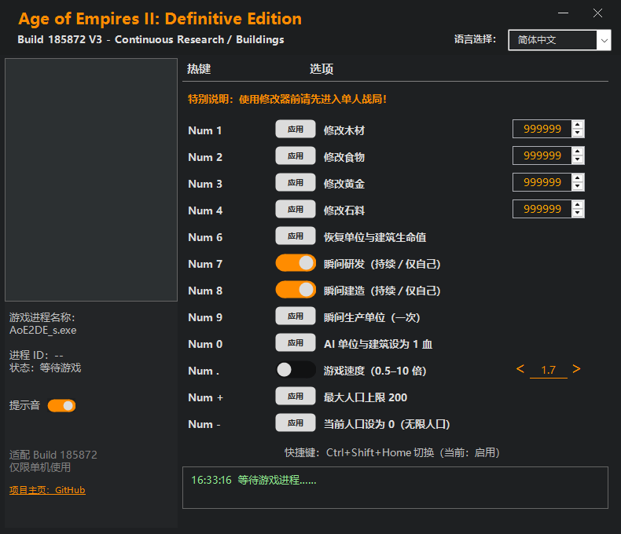

# Age of Empires II: Definitive Edition — Continuous Toggle Fork (+12)

[中文说明](#中文说明) · [Introduce](#introduce)

该修改器是免费使用的!
This Trainer is free to use!

本仓库是 [KagurazakaNatsuki/AOE2-Trainer](https://github.com/KagurazakaNatsuki/AOE2-Trainer) 的个人 fork，基于上游 **`v185872-V3`**，新增持续研究、持续建造开关。感谢原作者提供源码；本 fork 与 FLiNG 官方无隶属关系。

## 支持版本 / Compatibility

| 项目 | 当前支持 |
| --- | --- |
| 游戏 | Age of Empires II: Definitive Edition / 帝国时代 II：决定版 |
| 游戏 Build | **185872** |
| 游戏 EXE 文件版本 | **101.103.54800.0** |
| 游戏进程 | `AoE2DE_s.exe` |
| Fork 程序版本 | **1.0.0.41** |
| Fork 发布标签 | `v185872-continuous.2` |
| 运行环境 | Windows x64，.NET Framework 4.x |
| 使用范围 | 单人游戏 / 单人战役 |
| 其他游戏版本 | 未适配；不支持 Build 188329，不保证未来版本兼容 |

**下载：[本 fork 的 Releases](https://github.com/xiaoqi419/AOE2-Trainer/releases)。** 首版标记为预发布：10 项本地回归测试通过，尚未完成真实游戏对局验证。

## 新增功能 / Fork changes

- **内置窗口按钮（v1.0.0.41）**：移除 Windows 原生标题栏，右上角提供最小化和关闭按钮；拖动标题文字或顶部空白区域可移动窗口。最小化后持续功能继续运行；关闭仍经过原值恢复流程，恢复失败时可阻止关闭。

- **持续瞬间研究**：滑动开关或 `Num 7` 切换，开启期间自动处理后续研究任务。
- **持续瞬间建造**：滑动开关或 `Num 8` 切换，开启期间新建造任务也加速。
- **独立开关、默认关闭**：两个功能互不影响，切换界面语言后保留开关状态。
- **当前玩家隔离**：只写入当前玩家资源表，研究队列写入前重新校验建筑归属；代码及隔离测试覆盖 AI 排除，游戏内效果仍待验证。
- **精确恢复**：关闭或正常退出时恢复开启前数值，包括战役自定义倍率；不再把建造倍率固定重置成 1。
- **对局切换保护**：检测到游戏会话或玩家变化时关闭持续功能，避免向旧地址写入。
- **回归测试**：新增 `Test.ps1`，覆盖持续写入、关闭还原、无效值拒绝、恢复重试、玩家隔离、热键、界面状态。

瞬间生产（`Num 9`）仍为一次性操作。强制结束程序无法还原数值，已完成的任务不会因关闭开关而撤销。

This personal fork is based on upstream **`v185872-V3`** and targets **Build 185872 / file version 101.103.54800.0 only**. It adds independent persistent research and construction toggles, current-player ownership checks, exact value restoration, and session-change protection. Build 188329 is not supported. The first release is a **prerelease**: ten local regression tests pass, but live-game validation is still pending.

截图：本 fork 的无边框界面（测试渲染，演示开关开启状态；实际启动默认关闭）。源码构建不包含上游发布包的封面素材。

## 中文说明

### 持续开关版（Build 185872 V3）

- 瞬间研发和瞬间建造已改为持续开关，默认关闭。点击滑动开关或按 `Num 7` / `Num 8` 切换；开启后，新开始的对应任务也会加速。
- 两项功能只修改当前玩家。研究队列在每次写入前重新核对建筑归属，AI 不会获得这两项加速。
- 关闭开关或正常退出修改器时，恢复开启前的精确数值，保留战役原有倍率。切换对局或游戏退出后自动关闭，需在新对局重新开启。
- 持续效果需要修改器保持运行；强制结束进程无法执行还原。已完成的研究和建筑不会因关闭开关而撤销。
- 瞬间生产仍保留原来的一次性操作。支持游戏文件版本 `101.103.54800.0`。
- `./Build.ps1` 编译，`./Test.ps1` 执行本地内存与界面回归测试；测试不会修改运行中的游戏。

> **非官方说明：** 本项目参考风灵月影（FLiNG）修改器的界面风格与操作方式，主程序独立编写。它不是风灵月影官方作品，与风灵月影、Microsoft 或 World's Edge 均无隶属、合作或认可关系，请勿当作官方更新。

这是一个**仅供单机使用**的修改器。它直接修改运行中的游戏内存，不修改游戏安装目录。请在 [Releases](https://github.com/xiaoqi419/AOE2-Trainer/releases) 查看各版本的适配信息和下载文件。

### 下载和使用

1. 从 [Releases](https://github.com/xiaoqi419/AOE2-Trainer/releases) 下载与游戏版本对应的 EXE，并核对该版本发布说明中的 SHA-256。
2. 启动游戏，进入**单人战局**，再以管理员身份运行修改器。主菜单中只能检测进程，进入战局后才会显示“已连接 / 就绪”。
3. 木材、食物、黄金、石料分别输入数值并各自点击“应用”。其他功能也可用对应按钮或小键盘热键执行。
4. “瞬间研发 / 建造”是**持续开关**；“瞬间生产”仍为**一次性操作**。
5. 右上角的语言下拉菜单支持简体中文、繁體中文、English、Русский、Español、日本語、العربية、Français、Deutsch 和 한국어。启动时按系统界面语言自动选择；未适配的语言默认 English。

| 热键 | 功能 |
| --- | --- |
| Num 1 / 2 / 3 / 4 | 分别修改木材、食物、黄金、石料 |
| Num 6 | 恢复己方单位与建筑生命值 |
| Num 7 | 瞬间研发开关（持续，仅当前玩家） |
| Num 8 | 瞬间建造开关（持续，仅当前玩家） |
| Num 9 | 瞬间生产单位（一次） |
| Num 0 | 将 AI 单位与建筑设为 1 血 |
| Num . | 游戏速度（0.5–10 倍）开关 |
| Num + | 最大人口上限设为 200 |
| Num - | 当前人口设为 0 |
| Ctrl+Shift+Home | 启用／关闭功能快捷键（默认启用） |
| — | 提示音开关（左下角，默认开启；操作成功与关闭开关使用不同提示音） |

### 风险与限制

- **请先备份存档，风险自担。** 内存修改可能导致游戏闪退、异常数值或存档问题；本工具不提供稳定性保证。
- 仅限单机；请勿用于多人联机或受反作弊保护的环境。
- **游戏账号风险无法排除。** 官方说明作弊可能导致账号处罚，严重或重复违规可能被暂停聊天、多人服务甚至游戏访问；游戏也可能提示“Tampering Detected”。本项目没有获得单机修改器的官方豁免，不能保证只在单机使用就不会触发检测或处罚。请勿在联机、排位、赛事中运行；进入这些模式前关闭修改器。有关处罚和干扰检测，请阅读[官方封禁说明](https://support.ageofempires.com/hc/en-us/articles/360047397872-Age-of-Empires-II-Definitive-Edition-ban)及[官方 Tampering Detected 说明](https://support.ageofempires.com/hc/en-us/articles/28006568546708-Tampering-Detected-A-running-process-may-be-interfering-with-the-correct-operation-of-AoE2-DE)。
- 游戏更新后可能立即失效。若版本不符，修改器会拒绝连接；请查看对应版本的发布说明。
- EXE 没有数字签名；不要为了运行它而关闭杀毒软件或系统防护。
- 本地持续开关版已通过独立内存和界面回归测试，尚未在真实单人战局中验证。

如需反馈，请在 Issue 中提供游戏 Build、修改器版本、复现步骤和错误现象；不要上传个人信息、存档或含敏感数据的日志。

## Introduce

### Local continuous-toggle build (Build 185872 V3)

Version **1.0.0.41** removes the native title bar and adds integrated minimize/close buttons. Drag the title or header background to move the window. Minimize keeps continuous features running; close uses the normal restoration path and can be cancelled if restoration fails.

Instant Research and Instant Buildings are now independent, default-off switches. Click a switch or press `Num 7` / `Num 8` to toggle; newly started tasks are also affected while enabled. Only the current player's values and research queues are modified. Switching off or closing normally restores the exact saved values; changing matches disables both switches. Keep the trainer running while enabled. Force termination cannot restore values, and completed tasks are not undone. Instant Recruit remains a one-shot action. This local build targets game file version `101.103.54800.0`; run `./Test.ps1` for isolated memory and UI tests.

> **Unofficial project:** This independently written trainer takes inspiration from FLiNG's UI style and workflow. It is **not** an official FLiNG release and is not affiliated with, endorsed by, or sponsored by FLiNG, Microsoft, or World's Edge.

This trainer is for **single-player use only**. It modifies the running game's memory; it does not modify the game installation directory. See [Releases](https://github.com/xiaoqi419/AOE2-Trainer/releases) for version-specific compatibility and downloads.

### Download and use

1. Download the EXE matching your game version from [Releases](https://github.com/xiaoqi419/AOE2-Trainer/releases), and verify its SHA-256 against that release's notes.
2. Start the game and enter a **single-player match**, then run the trainer as administrator. Process detection in the main menu is normal; the trainer becomes ready after entering a match.
3. Enter and apply wood, food, gold, and stone amounts **separately**. Other features have individual buttons and numpad hotkeys.
4. Instant research and building are **persistent toggles**. Recruitment remains a **one-shot action** on the current queue.
5. The top-right dropdown supports Simplified Chinese, Traditional Chinese, English, Russian, Spanish, Japanese, Arabic, French, German, and Korean. The trainer selects the Windows UI language on startup; unsupported languages default to English.

| Hotkey | Feature |
| --- | --- |
| Num 1 / 2 / 3 / 4 | Edit wood, food, gold, and stone separately |
| Num 6 | Restore health of your units and buildings |
| Num 7 | Toggle continuous research (current player only) |
| Num 8 | Toggle continuous construction (current player only) |
| Num 9 | Instant recruit units (once) |
| Num 0 | Set AI units and buildings to 1 HP |
| Num . | Toggle game speed (0.5–10×) |
| Num + | Set maximum population cap to 200 |
| Num - | Set current population to 0 |
| Ctrl+Shift+Home | Enable/disable feature hotkeys (enabled by default) |
| — | Sound effects toggle (bottom-left, on by default; distinct cues for successful actions and disabling a toggle) |

### Risks and limitations

- **Back up saves and use at your own risk.** Memory editing may cause crashes, abnormal values, or save problems. No stability warranty is provided.
- Single-player only; do not use in multiplayer or anti-cheat-protected environments.
- **Account safety is not guaranteed.** The game publisher says cheating can result in account sanctions, potentially including loss of chat, multiplayer, or game access for severe or repeated violations. The game may also show a “Tampering Detected” warning. We have no official exemption for single-player trainers and cannot guarantee that single-player use is undetected or free of account consequences. Never run the trainer in multiplayer, ranked play, or tournaments; close it before entering those modes. See the [official ban guidance](https://support.ageofempires.com/hc/en-us/articles/360047397872-Age-of-Empires-II-Definitive-Edition-ban) and [tampering guidance](https://support.ageofempires.com/hc/en-us/articles/28006568546708-Tampering-Detected-A-running-process-may-be-interfering-with-the-correct-operation-of-AoE2-DE).
- A game update may break compatibility immediately. The trainer refuses to attach when the executable file version does not match; check the corresponding release notes.
- The EXE is unsigned. Do not disable antivirus or system protections to run it.
- This local continuous-toggle build has isolated memory and UI regression coverage; it has not been verified in a live single-player match.
For bug reports, open an Issue with the game build, trainer version, reproduction steps, and symptoms. Do not post personal data, save files, or sensitive logs.
